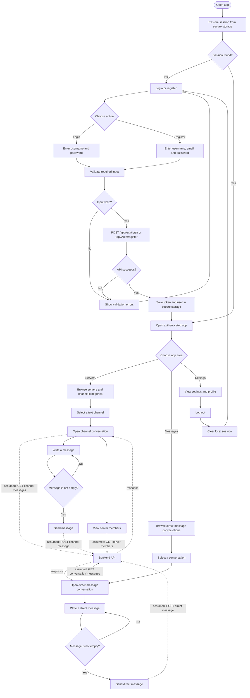
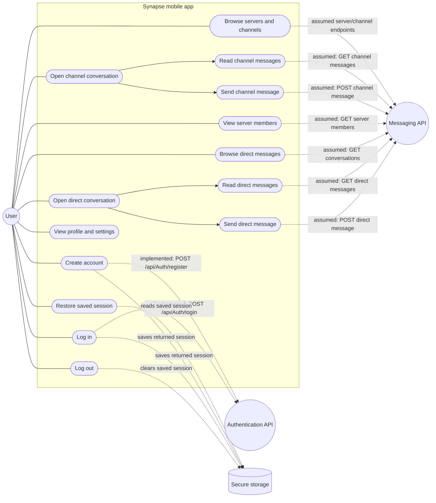

# Synapse project diagrams

These diagrams describe the current frontend and an assumed backend for the chat features. The app already calls the authentication API for login and registration. Server, channel, member, direct-message, message, and settings data are currently local/mock data; the API calls shown for them are proposed integration points, not implemented endpoints.

## Application flow

## Use-case diagram

The authenticated user interacts with the mobile app; the app calls the authentication API for the implemented login/register flows and would call the messaging API for the assumed chat flows.

## Assumed backend boundary

The only API routes currently present in the frontend are:

- `POST /api/Auth/login` with `{ username, password }`
- `POST /api/Auth/register` with `{ username, email, password }`

For the diagrams, the messaging API is assumed to provide authenticated endpoints to list servers/channels and conversations, retrieve channel/DM messages and server members, and send channel/DM messages. Exact route names, payloads, authorization rules, and error responses still need to be agreed with the backend implementation. The diagrams do not imply that these chat endpoints already exist.

Voice channels, search, starting a new conversation, invites, and most settings rows are currently presentation-only or have no action wired up, so they are not shown as completed use cases.
